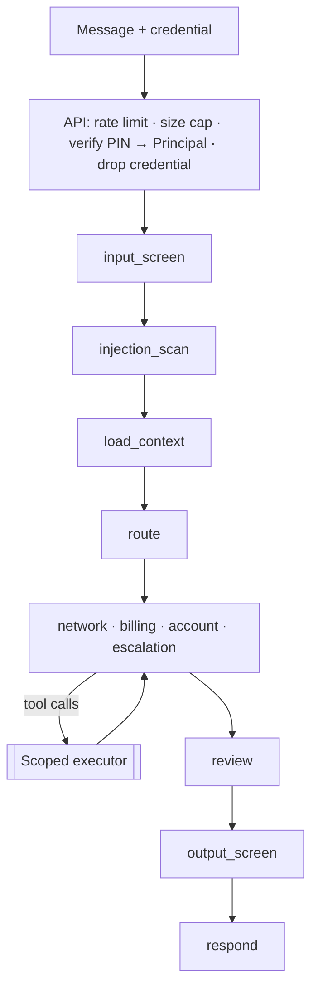

# Architecture overview

!!! info "In one paragraph, for a non-engineer"
    Every message passes through a fixed series of checks before an assistant is
    allowed to act on it, and every reply passes through another series before a
    customer sees it. The important design choice is that the most important
    checks do not depend on a model behaving well: what the assistant is allowed
    to *touch* is decided by code, from who the caller has proven they are.

The target graph (built across phases 1–5):

What exists today is the walking skeleton — `echo` then `done` — which proves the
streaming path, the request-size cap and the rate limit before any real node is
written.
